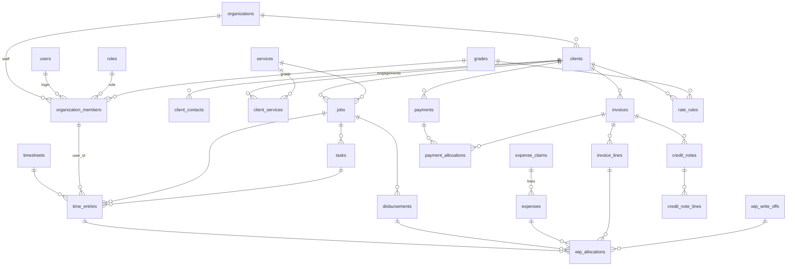

# Database

PostgreSQL (18 in Docker and CI; README requires 15 or newer). 96 tables, defined as SQLAlchemy
models in `app/db/models/` (one file per area, all imported by `app/db/models/__init__.py`) and
created only by the Alembic migrations in `alembic/versions/`. Business meaning of the columns is
in [domain.md](domain.md) and the module docs; this page is what you need to change the schema
safely.

## Conventions

| Topic | Convention | Evidence |
|---|---|---|
| Primary keys | `id UUID`, UUIDv7 generated in Python (`new_id`) | `IdMixin` in `app/db/base.py`, `app/utils/ids.py` |
| Timestamps | `created_at`, `updated_at` (`timestamptz`, default `now()`); `updated_at` is set by the `set_updated_at()` trigger, not by the ORM | `TimestampMixin`; migration `001` creates the function; `add_updated_at_trigger(s)` in `app/db/migration_helpers.py` |
| Tenancy | `organization_id UUID NOT NULL REFERENCES organizations ON DELETE CASCADE` | `OrgScopedMixin` |
| Soft delete | `deleted_at` on `organizations`, `users`, `roles`, `clients`, `jobs`, `invoices`, `invoice_templates`; `archived_at` on `vat_rates`, `leads` | `SoftDeleteMixin`; a staff member who is referenced is not hard-deleted, `organization_members.status` changes instead (`active`, `suspended`, `removed`, `inactive`, `left`, `deleted`) |
| Statuses and kinds | `text` columns with a `CHECK (... IN (...))`, no PostgreSQL enum types | e.g. `Timesheet.__table_args__` in `app/db/models/time.py` |
| Money | Integer pence (`BigInteger` for amounts and totals) | `app/utils/money.py`; `invoices.net_total`, `payments.amount` |
| Rates | Pence per hour (`charge_rate`, `cost_rate`, `default_charge_rate`, `hourly_rate`) | `TimeEntry` docstring |
| Percentages | Basis points in columns ending `_bp` (`vat_rate_bp` 2000 = 20%, `chargeable_target_bp`, `markup_bp`, `cost_plus_markup_bp`, `overtime_multiplier_bp`) | `app/utils/money.py: BASIS_POINTS` |
| Durations | Whole minutes (`minutes`, `budget_minutes`, `weekly_capacity_minutes`) | `ck_time_entries_minutes` (1..1440) |
| Quantities | `Numeric(12, 2)` on invoice, estimate and recurring lines | `app/db/models/billing.py`, `estimates.py` |
| Snapshots | Values copied at the time of the event, never recomputed: `time_entries.charge_rate/cost_rate/charge_value/cost_value/rate_source`, `invoice_lines.vat_rate_bp` | `TimeEntry` docstring, [domain.md](domain.md#conventions) |
| JSON | `JSONB` for free-form payloads (`audit_logs.metadata`, `background_jobs.payload`, `integration_sync_items.payload`) | `app/db/models/platform.py`, `integrations.py` |

### Constraint and index names

`Base.metadata` has a naming convention (`app/db/base.py: NAMING_CONVENTION`):

| Kind | Pattern | Example |
|---|---|---|
| Primary key | `pk_<table>` | `pk_branches` |
| Foreign key | `fk_<table>_<columns>_<referred table>` | `fk_time_entries_organization_id_client_id_clients` |
| Unique | `uq_<table>_<columns>` | `uq_timesheets_organization_id_user_id_week_start` |
| Check | `ck_<table>_<name>` (models pass the short name: `CheckConstraint(..., name="status")`) | `ck_timesheets_status` |
| Index | `ix_<table>_<columns>` | `ix_time_entries_organization_id_user_id_entry_date` |
| Exclusion | written out by hand | `ex_rate_rules_scope_period` |

Other recurring patterns:

* Case-insensitive uniqueness through an expression index named `uq_<table>_..._name_lower`
  (e.g. `uq_branches_organization_id_name_lower` on `lower(name)`).
* "Only one live row" through partial unique indexes named `..._live`
  (`uq_wip_allocations_time_entry_live`, `WHERE ... reversed_at IS NULL`): an item can be billed
  once at a time.
* Constraint names matter to the API: `UNIQUE_MESSAGES` in `app/core/handlers.py` maps unique
  constraint names to a field and message, and `ex_rate_rules_scope_period` maps to
  409 `RATE_OVERLAP`. Renaming one of those constraints changes the API's error answer.

## Tenancy

Every practice table carries `organization_id`. Parent tables also declare
`UNIQUE (organization_id, id)` (`uq_<table>_organization_id_id`) so that children use composite
foreign keys that include the practice:

```python
ForeignKeyConstraint(
    ["organization_id", "client_id", "job_id"],
    [
        "jobs.organization_id",
        "jobs.client_id",
        "jobs.id",
    ],  # the job must belong to the entry's client
    name="fk_time_entries_organization_id_client_id_job_id_jobs",
)
```

* People are referenced through the membership, not the user: columns such as
  `time_entries.user_id`, `clients.partner_user_id` and `tickets.assignee_user_id` hold a
  `users.id` but the foreign key is `(organization_id, <col>) → organization_members
  (organization_id, user_id)` (`_member_fk` in `app/db/models/clients.py`).
* Tables without `organization_id`: `users`, `user_sessions`, `refresh_tokens`,
  `email_verification_tokens`, `password_reset_tokens`, `permissions`, `role_permissions`,
  `rate_limit_counters`. `audit_logs` and `background_jobs` have a nullable `organization_id`
  without a foreign key (audit rows outlive everything; jobs can be global).
* Deleting an `organizations` row cascades to every practice table; the application only
  soft-deletes practices.

## Tables by area

Counts and key relations below are generated from `Base.metadata` (96 tables). "Org" means the
table has `organization_id`.

| Area (model file) | Tables | Key relations and notes |
|---|---|---|
| Accounts (`user.py`) | `users`, `user_sessions`, `refresh_tokens`, `email_verification_tokens`, `password_reset_tokens` | Not org-scoped. Tokens stored as SHA-256 hashes. `refresh_tokens.replaced_by_id` chains rotations. |
| Platform (`platform.py`) | `background_jobs`, `rate_limit_counters` (UNLOGGED), `audit_logs` | `audit_logs`: PK `(id, created_at)`, range-partitioned by month, append-only trigger (migration `043`). |
| Practice and access (`organization.py`) | `organizations`, `organization_members`, `roles`, `permissions`, `role_permissions`, `member_permission_overrides` | `organizations` holds the practice settings (time zone, working week, VAT, approval switches, `rate_mode`, period-lock and overtime settings, `branches_enabled`, ...). Member → role, grade, manager (self-reference). |
| Set-up (`practice.py`) | `vat_rates`, `activity_codes`, `services`, `service_activity_codes`, `service_task_templates`, `grades`, `document_sequences`, `segments`, `staff_segments`, `branches` | Seeded for each new practice (`app/services/practice_defaults.py`). `document_sequences` gives gapless numbers (`app/services/sequences.py`). |
| Rates (`rates.py`) | `rate_rules`, `rate_changes`, `rate_reruns`, `rate_rerun_items` | `rate_rules` has a `kind` (`charge`/`cost`; cost only at `staff` or `grade` level), a `level` and an effective period, with the exclusion constraint `ex_rate_rules_scope_period` against overlaps. [team-rates.md](modules/team-rates.md#rates) |
| Clients (`clients.py`) | `clients`, `client_contacts`, `client_services`, `engagement_job_runs`, `leads` | `clients` → partner/manager member, default VAT rate, default service, invoice template, branch, `merged_into_client_id`; `central_client_id` links to the central service; `is_internal` marks the built-in Internal client. |
| Jobs (`jobs.py`) | `jobs`, `job_assignees`, `tasks`, `task_assignees`, `job_budget_alerts` | `jobs` → client, service, partner/manager; `pm_job_id` links to practice management. |
| Time (`time.py`, `time_history.py`) | `timesheets`, `time_entries`, `timers`, `time_entry_history`, `timesheet_reminders` | Entry → timesheet, client, job (of that client), task (of that job), activity code, member. `billing_status` `unbilled → in_draft → billed / written_off`. |
| Billing (`billing.py`, `billing_workflow.py`) | `disbursements`, `wip_write_offs`, `wip_allocations`, `invoices`, `invoice_lines`, `credit_notes`, `credit_note_lines`, `payments`, `payment_allocations`, `invoice_approvals`, `payment_reminders`, `statement_sends` | `wip_allocations` ties one item (time entry, disbursement or expense) to one destination (invoice line or write-off). Totals guarded by checks (`ck_invoices_gross_total`, `ck_invoices_not_over_settled`). [billing.md](billing.md) |
| WIP ledger (`wip.py`) | `wip_movements`, `wip_adjustments`, `wip_transfers`, `credit_note_wip`, `wip_snapshots`, `wip_snapshot_items` | `wip_movements.reversal_of_id` self-reference; movements are reversed, not edited. [wip.md](modules/wip.md) |
| Estimates and recurring (`estimates.py`) | `estimates`, `estimate_lines`, `recurring_schedules`, `recurring_lines`, `recurring_runs` | Estimate → `converted_invoice_id`; run → invoice. |
| Expenses (`expenses.py`) | `expense_types`, `expense_claims`, `expense_claim_events`, `expenses`, `expense_receipts` | Expense line → claim, type, client, job, VAT rate; receipts are files in storage. [expenses.md](modules/expenses.md) |
| Period locks (`period_locks.py`) | `period_locks`, `locked_periods`, `period_lock_events` | [period-locks.md](modules/period-locks.md#data) |
| Notifications (`notifications.py`) | `notifications`, `notification_preferences`, `notification_settings`, `email_templates`, `message_log` | `message_log` is what the mock messaging gateway records. |
| Tickets (`tickets.py`) | `tickets`, `ticket_comments`, `ticket_attachments`, `ticket_tags`, `ticket_tag_links`, `ticket_status_history` | Attachments → ticket or comment; files in storage. |
| Invoice templates (`invoice_templates.py`) | `invoice_templates` | Soft-deleted; one default per practice. |
| Integrations (`integrations.py`) | `integration_connections`, `integration_sync_items`, `integration_sync_logs`, `integration_cursors`, `central_client_cache`, `bookkeeping_service_mappings`, `bookkeeping_vat_mappings` | Outbox items with an idempotency key per practice and integration. |
| Import, onboarding (`data_import.py`, `onboarding.py`) | `data_import_batches`, `data_import_rows`, `onboarding_progress` | |

## Core relationships

Only the main foreign keys; every table also references `organizations`.



## Migrations

### Layout

* Files: `alembic/versions/NNN_description.py` (`file_template = %%(rev)s_%%(slug)s` in
  `alembic.ini`). The revision id is the three-digit number as a string (`revision = "079"`,
  `down_revision = "078"`). The chain is linear with one head.
* 77 files, `001` to `079`. Numbers `071` and `072` do not exist: `073` revises `070`.
* `007`-`009`, `033`-`035`, `041`-`042` are empty placeholders (`upgrade`/`downgrade` are `pass`)
  that were reserved for parallel work. Leave them in place.
* `alembic/env.py` runs online through an async engine on `DB_DIRECT_URL` (else `DB_URL`) and
  ignores the runtime monthly partitions `audit_logs_*` when comparing.
* A post-write hook formats new revision files with `ruff format` (`alembic.ini`).

### Adding a migration

1. Change the model in `app/db/models/` first.
2. Create the file with the next number:
   `alembic revision -m "short description" --rev-id 080` (the `--rev-id` makes the
   number the revision id and the file name prefix).
3. Write the operations by hand. No file in `alembic/versions/` carries Alembic's autogenerate
   markers; if you start from `--autogenerate`, review every line and remove the markers.
4. Docstring: the description line, `Revision ID` / `Revises`, then the ticket (`Ticket APT79: ...`)
   and what the upgrade and the downgrade do to existing data (see `078_internal_client.py`,
   `079_staff_only_rate_mode.py`).
5. Name constraints exactly as the convention would and wrap them in `op.f(...)` so the
   convention is not applied twice: `op.f("ck_organizations_rate_mode")`.
6. A new table: `organization_id` with `ON DELETE CASCADE`, `UNIQUE (organization_id, id)` if
   other tables will reference it, composite foreign keys to other practice tables, and
   `add_updated_at_triggers("<table>")` (`app/db/migration_helpers.py`), or `updated_at` never
   changes.
7. A new permission: add it to `CATALOGUE` in `app/core/permissions.py`, call
   `sync_permissions()` in the migration, grant it to roles as needed, and update
   [modules/permissions.md](modules/permissions.md) (checked by `tests/test_permissions_doc.py`).
8. Data steps use `op.execute` with SQL, must be safe to run again, and must not import
   application services (the schema they assume may change later).
9. Check: `alembic upgrade head`, `alembic check` (models and migrations agree),
   `alembic downgrade -1`, `alembic upgrade head`.

### Downgrades

Every revision has a `downgrade()`. Recent ones reverse the schema and say in the docstring what
happens to data the old schema cannot hold (for example `079` turns `staff_only` into
`staff_first`; `078` keeps an Internal client that is still referenced). The test suite runs
`alembic downgrade base` then `upgrade head` at the start of every session
(`tests/conftest.py: _migrated_database`), so a broken downgrade breaks every test run.

### Migration tests

Migrations with data steps have a test that downgrades to the previous revision, checks the
data, and upgrades again in a `finally` block (`tests/test_staff_only_rate_mode_migration.py`,
helpers in `tests/migration_helpers.py`: `migrate`, `head_revision`). These tests are slow; see
[testing.md](testing.md#slow-areas).

### Deployment order

Migrations run once per release before the new API starts (`alembic upgrade head`, see
[deployment.md](deployment.md#releases)). `GET /health/ready` answers 503 until the database is at
the head revision. The API pull request, which carries the migrations, is deployed before the UI
pull request that depends on it.
