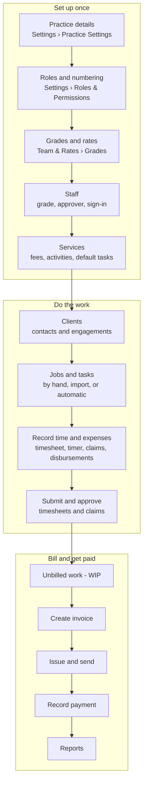
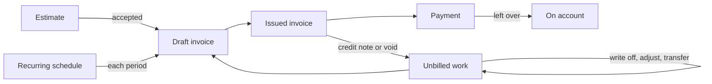

# How the product fits together

The same chart is in the app, under **Help › How it works**. Update both when the flow changes
(the app reads it from `capiumtimenfeeui/src/features/help/flowData.ts`).

## The main path

## Other routes

## Statuses

| Record | Path |
|---|---|
| Job | `planned → in_progress ↔ on_hold`, `in_progress → completed → closed`; `cancelled` from any open state |
| Timesheet | `open → submitted → approved`; `submitted → rejected → submitted`; recall `submitted → open`; reopen `approved → open` |
| Expense claim | `draft → submitted → approved`; `submitted → returned → submitted`; recall `submitted → draft` |
| Invoice | `draft → [awaiting_approval → approved] → issued → void`; derived: `credited`, `paid`, `overdue`, `part_paid` |
| Estimate | `draft → sent → accepted | declined`; derived `expired`; converts to a draft invoice |
| Time and expense items (WIP) | `unbilled → in_draft → billed`, or `unbilled → written_off`; void returns `billed → unbilled` |
| Ticket | `open, in_progress, requirement_pending, clarification_required, blocked, ready_for_ba_review, reopened, closed, invalid, on_hold`; any status may follow any other |

## Before you start

* **Rates before time.** Time is valued at the rate in force when it is saved. Without rates it is worth £0;
  *Team & Rates › Change Rates on Past Time* re-prices unbilled time.
* **A sign-in for people who submit or approve.** A staff member without one is a placeholder: a manager
  records their time and it never reaches approval on its own.
* **Approval and WIP.** With timesheet approval on, time that is not approved is not unbilled work.
* **Engagements and automatic jobs** need `auto_create_jobs`, a start date and an active client and service;
  jobs are created from the start of the period window and never for the past.
* **Locked weeks and periods** refuse changes; a manager reopens the week.

See `docs/domain.md` for the rules behind each of these and `docs/modules/permissions.md` for the roles.
