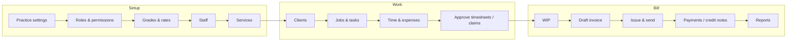

# Capium Time & Fees: system overview

The one-page map of the whole product across its two repositories. Start here, then follow the
links: each area has a detailed doc. This file is kept **identical in both repositories**
(`docs/system-overview.md`); change both together.

| Repository                                                            | What it is                                                                        | Entry point                                                                       |
| --------------------------------------------------------------------- | --------------------------------------------------------------------------------- | --------------------------------------------------------------------------------- |
| [`capiumtimenfeeapi`](https://github.com/DexaiTech/capiumtimenfeeapi) | FastAPI + SQLAlchemy (async) + Alembic + PostgreSQL API, and a worker process     | [`CLAUDE.md`](https://github.com/DexaiTech/capiumtimenfeeapi/blob/main/CLAUDE.md) |
| [`capiumtimenfeeui`](https://github.com/DexaiTech/capiumtimenfeeui)   | React + TypeScript + Vite single-page app (TanStack Query, react-router, zustand) | [`CLAUDE.md`](https://github.com/DexaiTech/capiumtimenfeeui/blob/main/CLAUDE.md)  |

## 1. What the product does

Time recording and billing for UK accountancy practices. A practice sets up its staff, grades,
charge-out and cost rates and services; records time and expenses against clients and jobs;
approves timesheets; turns the unbilled work (WIP) into invoices; sends them, records payments
and credit notes; and reports on recovery, WIP and debtors. Each practice is a tenant
(`organization`); people sign in with an account and work inside one or more practices.

The end-to-end path (from [`docs/flow.md`](https://github.com/DexaiTech/capiumtimenfeeapi/blob/main/docs/flow.md)):



## 2. How the pieces run

```text
Browser ──HTTPS──► UI container (nginx, static build) ──/api/*──► API container ──► PostgreSQL
                                                                    │
                                                         Worker container (emails, PDFs, jobs)
```

- **One site, two apps.** The UI calls the API at `/api/v1` on the same origin (Vite proxies it in
  development; nginx in production), so the refresh-token cookie (scoped to `/api/v1/auth`) stays
  same-site. Access tokens are short-lived JWTs held in memory by the UI.
- **Containers.** API, worker and UI are three containers built from each repo's `Dockerfile`
  (deployed with Coolify). Migrations run once per release, before the new API starts
  (`alembic upgrade head` as the API's pre-deployment command). Details:
  [`docs/deployment.md`](https://github.com/DexaiTech/capiumtimenfeeapi/blob/main/docs/deployment.md).
- **Release order.** API first (it may carry migrations), then UI. Both repos merge with
  **rebase**. The API repo's CI (GitHub Actions) runs lint, format, mypy, migrations and the full
  test suite on every PR; the UI repo has no CI, so its checks are run locally.
- **Integrations.** Capium Central (the central client service) sits behind a gateway interface
  with an in-memory mock today; messaging is SMTP or a mock that records messages; uploads go to
  local storage or S3. See the API [`architecture.md`](https://github.com/DexaiTech/capiumtimenfeeapi/blob/main/docs/architecture.md).

## 3. Cross-cutting rules (both repos)

| Rule                                                                                                                                         | Where it is enforced                                                            | Read                                                                                                                                                                                                                       |
| -------------------------------------------------------------------------------------------------------------------------------------------- | ------------------------------------------------------------------------------- | -------------------------------------------------------------------------------------------------------------------------------------------------------------------------------------------------------------------------- |
| Every practice route is under `/api/v1/organizations/{id}`; data never crosses practices                                                     | API services/repositories (`organization_id` on every practice table)           | API [`architecture.md`](https://github.com/DexaiTech/capiumtimenfeeapi/blob/main/docs/architecture.md), [`database.md`](https://github.com/DexaiTech/capiumtimenfeeapi/blob/main/docs/database.md)                         |
| Permissions: 65 codes, 7 system roles + custom roles; the API is the authority, the UI only hides what the user can't do                     | API `app/core/permissions.py`, policy checks; UI `PERMISSIONS` + `useOrg().can` | API [`modules/permissions.md`](https://github.com/DexaiTech/capiumtimenfeeapi/blob/main/docs/modules/permissions.md), UI [`architecture.md`](https://github.com/DexaiTech/capiumtimenfeeui/blob/main/docs/architecture.md) |
| Money in pence (integers), rates and percentages in basis points, dates in the practice's time zone                                          | API schemas and services; UI `utils/money`, `utils/dates`                       | API [`domain.md`](https://github.com/DexaiTech/capiumtimenfeeapi/blob/main/docs/domain.md), [`coding-standards.md`](https://github.com/DexaiTech/capiumtimenfeeapi/blob/main/docs/coding-standards.md)                     |
| Charge-out rates resolve through one ladder (seven levels, then the practice default; rate mode `staff_first`, `grade_only` or `staff_only`) | API `RateBook` (`app/services/charge_rates.py`)                                 | API [`modules/team-rates.md`](https://github.com/DexaiTech/capiumtimenfeeapi/blob/main/docs/modules/team-rates.md)                                                                                                         |
| Issued invoices are locked; corrections go through credit notes; locked periods refuse changes                                               | API billing and period-lock services                                            | API [`billing.md`](https://github.com/DexaiTech/capiumtimenfeeapi/blob/main/docs/billing.md), [`modules/period-locks.md`](https://github.com/DexaiTech/capiumtimenfeeapi/blob/main/docs/modules/period-locks.md)           |
| Every change worth tracing writes an audit entry                                                                                             | API audit service                                                               | API [`modules/audit.md`](https://github.com/DexaiTech/capiumtimenfeeapi/blob/main/docs/modules/audit.md)                                                                                                                   |
| One shared component per UI pattern (grids, row actions, dialogs, filters, search, forms)                                                    | UI `src/components/ui`                                                          | UI [`ui-standards.md`](https://github.com/DexaiTech/capiumtimenfeeui/blob/main/docs/ui-standards.md)                                                                                                                       |

## 4. Area map: where each part of the product lives

| Area                                                                     | API module doc                                                                                                                                                                                                                                                                                                      | UI feature folder                     | UI doc                                                                                                                                                                                                                       |
| ------------------------------------------------------------------------ | ------------------------------------------------------------------------------------------------------------------------------------------------------------------------------------------------------------------------------------------------------------------------------------------------------------------- | ------------------------------------- | ---------------------------------------------------------------------------------------------------------------------------------------------------------------------------------------------------------------------------- |
| Sign-in, accounts, sessions                                              | [`foundation.md`](https://github.com/DexaiTech/capiumtimenfeeapi/blob/main/docs/modules/foundation.md)                                                                                                                                                                                                              | `src/features/auth`, `account`        | [`module-map.md`](https://github.com/DexaiTech/capiumtimenfeeui/blob/main/docs/module-map.md)                                                                                                                                |
| Practice settings, numbering, branches, segments, onboarding             | [`foundation.md`](https://github.com/DexaiTech/capiumtimenfeeapi/blob/main/docs/modules/foundation.md)                                                                                                                                                                                                              | `settings`, `organizations`, `system` | [`design/settings-billing.md`](https://github.com/DexaiTech/capiumtimenfeeui/blob/main/docs/design/settings-billing.md)                                                                                                      |
| Roles and permissions                                                    | [`permissions.md`](https://github.com/DexaiTech/capiumtimenfeeapi/blob/main/docs/modules/permissions.md)                                                                                                                                                                                                            | `settings` (roles)                    | [`module-map.md`](https://github.com/DexaiTech/capiumtimenfeeui/blob/main/docs/module-map.md)                                                                                                                                |
| Staff, grades, charge-out and cost rates, re-rating                      | [`team-rates.md`](https://github.com/DexaiTech/capiumtimenfeeapi/blob/main/docs/modules/team-rates.md)                                                                                                                                                                                                              | `team`                                | [`design/team-rates.md`](https://github.com/DexaiTech/capiumtimenfeeui/blob/main/docs/design/team-rates.md)                                                                                                                  |
| Clients, contacts, leads, client 360, central clients                    | [`clients.md`](https://github.com/DexaiTech/capiumtimenfeeapi/blob/main/docs/modules/clients.md), [`central-clients.md`](https://github.com/DexaiTech/capiumtimenfeeapi/blob/main/docs/modules/central-clients.md)                                                                                                  | `clients`                             | [`design/clients-page.md`](https://github.com/DexaiTech/capiumtimenfeeui/blob/main/docs/design/clients-page.md), [`design/client-360.md`](https://github.com/DexaiTech/capiumtimenfeeui/blob/main/docs/design/client-360.md) |
| Jobs, tasks, services, budgets                                           | [`time.md`](https://github.com/DexaiTech/capiumtimenfeeapi/blob/main/docs/modules/time.md), [`domain.md`](https://github.com/DexaiTech/capiumtimenfeeapi/blob/main/docs/domain.md)                                                                                                                                  | `jobs`                                | [`module-map.md`](https://github.com/DexaiTech/capiumtimenfeeui/blob/main/docs/module-map.md)                                                                                                                                |
| Time entries, timesheets, timer, approvals                               | [`time.md`](https://github.com/DexaiTech/capiumtimenfeeapi/blob/main/docs/modules/time.md)                                                                                                                                                                                                                          | `time`                                | [`module-map.md`](https://github.com/DexaiTech/capiumtimenfeeui/blob/main/docs/module-map.md)                                                                                                                                |
| Expenses, claims, disbursements, receipts                                | [`expenses.md`](https://github.com/DexaiTech/capiumtimenfeeapi/blob/main/docs/modules/expenses.md)                                                                                                                                                                                                                  | `expenses`                            | [`module-map.md`](https://github.com/DexaiTech/capiumtimenfeeui/blob/main/docs/module-map.md)                                                                                                                                |
| WIP, write-offs, transfers                                               | [`wip.md`](https://github.com/DexaiTech/capiumtimenfeeapi/blob/main/docs/modules/wip.md)                                                                                                                                                                                                                            | `wip`                                 | [`design/wip.md`](https://github.com/DexaiTech/capiumtimenfeeui/blob/main/docs/design/wip.md)                                                                                                                                |
| Invoices, credit notes, payments, recurring invoices, estimates, debtors | [`billing.md`](https://github.com/DexaiTech/capiumtimenfeeapi/blob/main/docs/modules/billing.md), [`../billing.md`](https://github.com/DexaiTech/capiumtimenfeeapi/blob/main/docs/billing.md), [`invoice-templates.md`](https://github.com/DexaiTech/capiumtimenfeeapi/blob/main/docs/modules/invoice-templates.md) | `billing`                             | [`module-map.md`](https://github.com/DexaiTech/capiumtimenfeeui/blob/main/docs/module-map.md)                                                                                                                                |
| Period locks                                                             | [`period-locks.md`](https://github.com/DexaiTech/capiumtimenfeeapi/blob/main/docs/modules/period-locks.md)                                                                                                                                                                                                          | `settings`                            | [`module-map.md`](https://github.com/DexaiTech/capiumtimenfeeui/blob/main/docs/module-map.md)                                                                                                                                |
| Dashboard and reports (recovery, WIP, debtors, exports)                  | [`dashboard.md`](https://github.com/DexaiTech/capiumtimenfeeapi/blob/main/docs/modules/dashboard.md), [`reports.md`](https://github.com/DexaiTech/capiumtimenfeeapi/blob/main/docs/modules/reports.md)                                                                                                              | `dashboard`, `reports`                | [`module-map.md`](https://github.com/DexaiTech/capiumtimenfeeui/blob/main/docs/module-map.md)                                                                                                                                |
| Imports and exports                                                      | [`import-export.md`](https://github.com/DexaiTech/capiumtimenfeeapi/blob/main/docs/modules/import-export.md)                                                                                                                                                                                                        | several features                      | [`module-map.md`](https://github.com/DexaiTech/capiumtimenfeeui/blob/main/docs/module-map.md)                                                                                                                                |
| Notifications and email                                                  | [`notifications.md`](https://github.com/DexaiTech/capiumtimenfeeapi/blob/main/docs/modules/notifications.md)                                                                                                                                                                                                        | `notifications`                       | [`design/notifications.md`](https://github.com/DexaiTech/capiumtimenfeeui/blob/main/docs/design/notifications.md)                                                                                                            |
| Audit log                                                                | [`audit.md`](https://github.com/DexaiTech/capiumtimenfeeapi/blob/main/docs/modules/audit.md)                                                                                                                                                                                                                        | `audit`                               | [`module-map.md`](https://github.com/DexaiTech/capiumtimenfeeui/blob/main/docs/module-map.md)                                                                                                                                |
| Application Testing tickets (in-app bug tracker)                         | [`tickets.md`](https://github.com/DexaiTech/capiumtimenfeeapi/blob/main/docs/modules/tickets.md)                                                                                                                                                                                                                    | `tickets`                             | [`module-map.md`](https://github.com/DexaiTech/capiumtimenfeeui/blob/main/docs/module-map.md)                                                                                                                                |
| Help pages                                                               | none                                                                                                                                                                                                                                                                                                                | `help`                                | [`module-map.md`](https://github.com/DexaiTech/capiumtimenfeeui/blob/main/docs/module-map.md)                                                                                                                                |

Endpoint by endpoint, with permissions: API [`api-reference.md`](https://github.com/DexaiTech/capiumtimenfeeapi/blob/main/docs/api-reference.md).
Tables and relationships: API [`database.md`](https://github.com/DexaiTech/capiumtimenfeeapi/blob/main/docs/database.md).

## 5. Documentation map

| Question                        | API repo                                                                                                                                                                                                                                                                                  | UI repo                                                                                                                                                                                          |
| ------------------------------- | ----------------------------------------------------------------------------------------------------------------------------------------------------------------------------------------------------------------------------------------------------------------------------------------- | ------------------------------------------------------------------------------------------------------------------------------------------------------------------------------------------------ |
| How do I run, test and deliver? | [`CLAUDE.md`](https://github.com/DexaiTech/capiumtimenfeeapi/blob/main/CLAUDE.md), [`testing.md`](https://github.com/DexaiTech/capiumtimenfeeapi/blob/main/docs/testing.md), [`README.md`](https://github.com/DexaiTech/capiumtimenfeeapi/blob/main/README.md)                            | [`CLAUDE.md`](https://github.com/DexaiTech/capiumtimenfeeui/blob/main/CLAUDE.md), [`testing.md`](https://github.com/DexaiTech/capiumtimenfeeui/blob/main/docs/testing.md)                        |
| How is the code organised?      | [`architecture.md`](https://github.com/DexaiTech/capiumtimenfeeapi/blob/main/docs/architecture.md)                                                                                                                                                                                        | [`architecture.md`](https://github.com/DexaiTech/capiumtimenfeeui/blob/main/docs/architecture.md), [`module-map.md`](https://github.com/DexaiTech/capiumtimenfeeui/blob/main/docs/module-map.md) |
| What are the business rules?    | [`domain.md`](https://github.com/DexaiTech/capiumtimenfeeapi/blob/main/docs/domain.md), [`flow.md`](https://github.com/DexaiTech/capiumtimenfeeapi/blob/main/docs/flow.md), [`billing.md`](https://github.com/DexaiTech/capiumtimenfeeapi/blob/main/docs/billing.md), `docs/modules/*.md` | `docs/design/*.md`                                                                                                                                                                               |
| What does the data look like?   | [`database.md`](https://github.com/DexaiTech/capiumtimenfeeapi/blob/main/docs/database.md)                                                                                                                                                                                                | `src/types`                                                                                                                                                                                      |
| Which endpoint and permission?  | [`api-reference.md`](https://github.com/DexaiTech/capiumtimenfeeapi/blob/main/docs/api-reference.md)                                                                                                                                                                                      | [`module-map.md`](https://github.com/DexaiTech/capiumtimenfeeui/blob/main/docs/module-map.md) (endpoints each feature calls)                                                                     |
| How should it look and behave?  | none                                                                                                                                                                                                                                                                                      | [`ui-standards.md`](https://github.com/DexaiTech/capiumtimenfeeui/blob/main/docs/ui-standards.md) (incl. known inconsistencies)                                                                  |
| How should code be written?     | [`coding-standards.md`](https://github.com/DexaiTech/capiumtimenfeeapi/blob/main/docs/coding-standards.md)                                                                                                                                                                                | [`coding-standards.md`](https://github.com/DexaiTech/capiumtimenfeeui/blob/main/docs/coding-standards.md)                                                                                        |
| How is it deployed?             | [`deployment.md`](https://github.com/DexaiTech/capiumtimenfeeapi/blob/main/docs/deployment.md)                                                                                                                                                                                            | [`README.md`](https://github.com/DexaiTech/capiumtimenfeeui/blob/main/README.md)                                                                                                                 |

## 6. How a ticket is worked

Every client ticket (APTnn from the Application Testing dashboard) follows the nine-step workflow
in each repo's `CLAUDE.md`: understand → investigate every screen that shares the behaviour →
root cause with code references → plan in `docs/implementation-plans/<TICKET_ID>.md` and **wait
for approval** → implement with shared components → verify every related screen → full
regression checks → manual check (local vs production stated) → final report table. Tickets are
never closed by the engineer, and nothing is merged or deployed without explicit approval. A
ticket that touches both repos gets one PR per repo; the API PR is released first.
